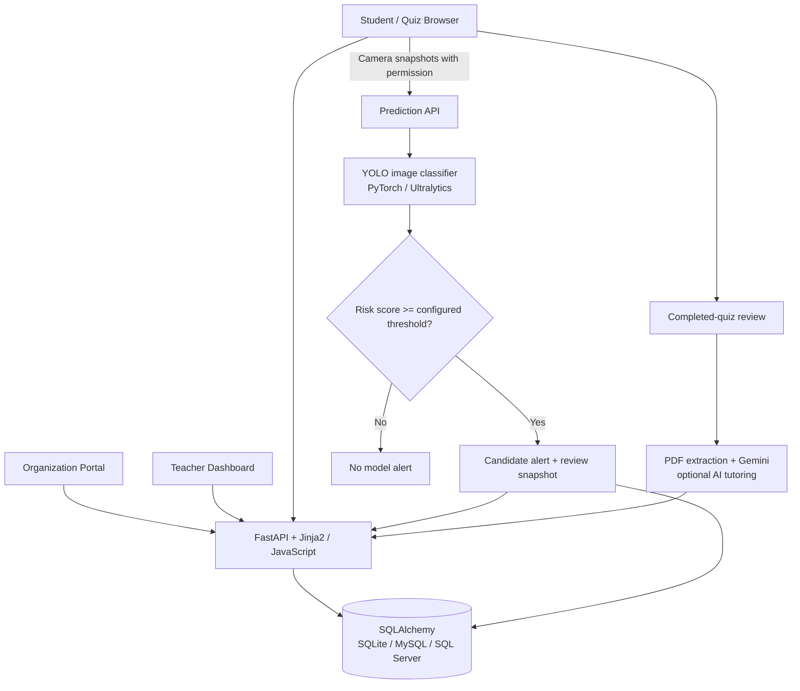

<div align="center">

# Code AI Proctor
### AI-Assisted Exam Integrity · Intelligent Quiz Platform · Adaptive Learning

**A self-hosted academic prototype that connects online assessments, webcam-based risk signals, teacher review, and AI-supported learning.**

<p>


</p>

**[Tech Stack](#technology-stack) · [Features](#platform-capabilities) · [Architecture](#system-architecture) · [Run Locally](#getting-started) · [Safety](#responsible-use--security)**

</div>

---

## Technology Stack

<table>
<tr>
<td valign="top" width="33%">
<h3>AI &amp; Vision</h3>
<p>


</p>
<sub>Binary image classification, frame/batch inference and candidate alert signals.</sub>
</td>
<td valign="top" width="33%">
<h3>Backend &amp; API</h3>
<p>


</p>
<sub>Server-side inference, account/quiz workflows, validation and JSON APIs.</sub>
</td>
<td valign="top" width="33%">
<h3>Web Platform</h3>
<p>


</p>
<sub>Organization, teacher, student and quiz-facing browser experiences.</sub>
</td>
</tr>
<tr>
<td valign="top" width="33%">
<h3>Database</h3>
<p>


</p>
<sub>Optional persistent accounts, classes, quiz attempts, incidents and grades.</sub>
</td>
<td valign="top" width="33%">
<h3>Generative AI</h3>
<p>


</p>
<sub>PDF-informed explanations, question practice and teacher insights.</sub>
</td>
<td valign="top" width="33%">
<h3>Tooling &amp; Extensions</h3>
<p>


</p>
<sub>Container configuration, experimental extension shell and optional GPU training.</sub>
</td>
</tr>
</table>

## Platform Capabilities

<table>
<tr>
<td valign="top" width="25%"><strong>Organization Management</strong><br/><sub>Create and manage institutional teacher/student accounts.</sub></td>
<td valign="top" width="25%"><strong>Assessment Workspace</strong><br/><sub>Classes, quizzes, questions, timed attempts and grading.</sub></td>
<td valign="top" width="25%"><strong>AI-Assisted Proctoring</strong><br/><sub>Classify webcam frames and surface candidate risk alerts.</sub></td>
<td valign="top" width="25%"><strong>Learning Feedback</strong><br/><sub>Quiz review, PDF-based assistance and practice generation.</sub></td>
</tr>
</table>

> [!IMPORTANT]
> **Human review is essential.** The image model produces a probability for a training-set label ("cheating" or "normal"). This is **not proof of academic misconduct**, identity authentication or a validated surveillance decision. Automated flags must never be used as the sole basis for disciplinary action. No independently verified recognition accuracy, fairness analysis or real-world false-positive rate is provided in this repository.

## Product Overview

Code AI Proctor (internally named **AI Observer**) combines a browser-based examination platform with a Python inference service. Institutions can create accounts, instructors can organize classes and quizzes, and students can take timed online assessments.

During an assessment, the browser can request webcam permission through `getUserMedia` and send images to the local FastAPI server. A trained **Ultralytics YOLO classification checkpoint** predicts class probabilities. The application can generate alerts and store incident-related records for teacher review when a database is configured.

A separate Gemini integration offers study-oriented feedback after quizzes. It extracts text from teacher-provided PDF lectures and uses that material in prompts to generate explanations and additional practice questions. **This is direct PDF-text context assembly, not a published vector-database RAG pipeline**.

## System Architecture



**Architecture boundaries:** the model runs in the **Python backend**, not within browser JavaScript; the UI submits images via HTTP. Database-backed registration, quiz storage and incident history require a valid `DB_CONNECTION_STRING`. The basic prediction endpoint can operate without database persistence when weights are available.

### Model inference pipeline

1. The browser uploads image frames to `POST /api/predict` or a window of frames to `POST /api/predict_batch`.
2. Pillow decodes the image; NumPy arrays are passed to `CheatingDetector`.
3. The detector center-crops nonsquare image arrays and runs an Ultralytics **classification** model.
4. Per-class probabilities are returned; `PROCTOR_CHEAT_THRESHOLD` is compared against the `cheating` class probability.
5. Batch prediction averages per-frame cheating probabilities and can return the highest-scoring submitted snapshot for review when flagged.
6. When the database is available, the prediction or subsequent incident report can be persisted.

A high model score reflects its learned dataset categories, **not a causal determination about student behavior**. Batch averaging can reduce some volatility but does not establish robust anti-cheating accuracy.

## Exam & Learning Workflow

**Institution → Teacher → Student → Assessment → Review**

1. **Institution:** sign up, log in and provision teacher or student accounts.
2. **Teacher:** create a class, structure course content, upload lecture PDFs, create quizzes and questions, generate a shareable exam link.
3. **Student:** log in, change the initial password as needed, enroll in a class, start a permitted quiz and submit responses.
4. **AI proctor:** with camera permission, classify selected frames; the application can report suspected events to a teacher.
5. **Review:** view grades, incident notifications and appeals; export grade data.
6. **AI tutoring:** review weak or overtime answers, use extracted lecture text to request explanations or generate practice questions through Gemini.

The system includes **organization, teacher, student, quiz and review templates**, plus static CSS and JavaScript. The separate `extension/` directory contains an early Chrome Manifest V3 scaffold (focus/blur logging and heartbeat handling), **not a completed browser-wide monitoring or enforcement system**.

## Repository Structure

```text
code-ai-proctor/
├── backend/
│   ├── main.py                       # FastAPI app, routes and inference API
│   ├── core/security.py              # bcrypt hashing helpers
│   ├── services/ai_tutor.py          # Gemini/PDF-based tutoring workflows
│   ├── templates/                    # Organization, teacher, student, quiz and review pages
│   └── static/                       # Browser CSS and JavaScript
├── extension/                         # Experimental Chrome MV3 scaffold
├── cheating_detector.py              # YOLO classification and batch aggregation
├── train_cheating_yolo.py            # GPU-oriented classification training
├── prepare_demo_weights.py           # Synthetic demo checkpoint generator
├── model_paths.py                    # Weight selection and discovery
├── database.py                       # SQLAlchemy models and persistence
├── cheating_dataset.yaml             # Dataset path/config reference
├── weights/.gitkeep                   # Weights directory (real weights not published)
├── requirements.txt
├── .env.example
├── Dockerfile
├── docker-compose.yml
├── project_documentation.md
└── README.md
```

### Backend data model

The SQLAlchemy models cover application users, organizations, teachers, students, classes, class enrollment, quizzes, questions, attempts, answers, answer timing, candidate cheating incidents and recorded predictions. See [database.py](database.py) for actual fields, relationships and backend-specific schema handling.

Database support includes **SQLite**, **MySQL** through PyMySQL, and **SQL Server/Azure SQL** through pyodbc. It is optional for isolated inference, but **required for account management and the quiz platform**.

## Getting Started

### Requirements

- Python with a virtual environment and supported versions of the packages in [requirements.txt](requirements.txt).
- A CPU or compatible NVIDIA GPU; model **training** in `train_cheating_yolo.py` requires CUDA, while the inference engine may use CPU.
- A classification checkpoint trained for `cheating` and `normal`, or synthetic demo weights **only for integration testing**.
- For the full portals: a configured SQL database; for tutoring: an optional Gemini API key.
- A webcam and browser camera permission for live testing.

### 1. Clone and install

```powershell
git clone https://github.com/AdhamElsayedAI/code-ai-proctor.git
cd code-ai-proctor
python -m venv .venv
.\\.venv\\Scripts\\Activate.ps1
python -m pip install -r requirements.txt
```

On Windows PowerShell, if activation is blocked, use `.\\.venv\\Scripts\\python.exe` in place of `python`. **PyTorch is intentionally not pinned in the requirements file.** Select a compatible CPU/CUDA installation command from the [official PyTorch guide](https://pytorch.org/get-started/locally/) before importing or running Ultralytics. Do not assume that a default wheel enables CUDA.

### 2. Configure your local environment

Copy `.env.example` to `.env` and edit it for a **local development environment**:

```dotenv
DB_CONNECTION_STRING=sqlite:///./ai_observer.db
PROCTOR_DEVICE=cpu
PROCTOR_CHEAT_THRESHOLD=0.7
PROCTOR_BATCH_SIZE=3
# PROCTOR_API_KEY=your-private-dev-key
# PROCTOR_MODEL_PATH=weights/best.pt
# GEMINI_API_KEY=your-private-key
```

This example uses **SQLite** to avoid a separate database server. The supplied `.env.example` also contains alternative XAMPP/MySQL and SQL Server configuration. Never commit `.env` or database files.

**API-key caution:** enabling `PROCTOR_API_KEY` requires clients to send the key in `X-API-Key` on prediction requests; do not embed a private server key into publicly distributed browser code.

### 3. Supply a suitable classification checkpoint

The repository's `weights/` directory is intentionally empty apart from `.gitkeep`. Place a compatible, consented/trained checkpoint at `weights/best.pt`, or set `PROCTOR_MODEL_PATH`.

```powershell
# Real dataset training: CUDA-capable system and dataset required
python train_cheating_yolo.py --data "path/to/dataset" --epochs 50 --batch 8 --workers 0
```

The training script defaults to Ultralytics `yolo11n-cls.pt` and writes results to `runs/classify/`. `model_paths.py` prioritizes some historical `train4` paths when those weights exist, and otherwise discovers other saved runs or uses `weights/best.pt`.

**For interface wiring only:**

```powershell
python prepare_demo_weights.py
```

This creates a checkpoint from a **tiny synthetic dataset**. It can help test whether requests reach the model, but its predictions are **not evidence of reliable cheating detection**.

### 4. Start the local application

```powershell
python -m uvicorn backend.main:app --host 127.0.0.1 --port 8000
```

Open **http://127.0.0.1:8000/** for the portal, **http://127.0.0.1:8000/docs** for FastAPI OpenAPI docs, and **http://127.0.0.1:8000/health** for model/database readiness. A running web server does not guarantee that valid model weights or database connectivity are present; confirm those separately.

### 5. Try the prediction API

For an environment with weights loaded and no API key set:

```bash
curl -X POST "http://127.0.0.1:8000/api/predict" \
  -F "file=@sample_frame.jpg"
```

If `PROCTOR_API_KEY` is configured, add the `X-API-Key` header. The response provides the model's label, confidence, probability map, `cheat_probability` and boolean `alert`. Use `POST /api/predict_batch` with repeated `files` fields for multi-frame average scoring, subject to the configured batch size.

The project is not a hosted inference service. **All model execution occurs on the Python host running FastAPI.**

## API Overview

| Route | Role |
| --- | --- |
| `GET /health`, `GET /api/meta` | Readiness and service metadata |
| `POST /api/org/signup`, `POST /api/org/login` | Institution registration and login |
| `POST /api/org/teachers`, `POST /api/org/students` | Account provisioning |
| `POST /api/teacher/classes`, `POST /api/teacher/quizzes` | Class and quiz authoring |
| `POST /api/teacher/classes/{class_id}/upload_lecture` | Lecture upload for course context |
| `POST /api/student/login`, `POST /api/student/join-class` | Student account and enrollment |
| `GET /api/quiz/{share_token}` | Retrieve shared assessment |
| `POST /api/quiz/{share_token}/start`, `POST /api/quiz/answer` | Quiz attempt lifecycle |
| `POST /api/quiz/attempt/{attempt_id}/complete` | Finish assessment |
| `POST /api/predict`, `POST /api/predict_batch` | Single-frame and batch model inference |
| `POST /api/cheating/report` | Report an incident for review |
| `POST /api/student/quiz/{attempt_id}/review` | Completed-quiz review and Gemini explanations |
| `POST /api/student/quiz/{attempt_id}/practice` | AI-generated practice questions |
| `POST /api/teacher/quiz/{quiz_id}/insights` | Teacher-side Gemini quiz insights |

See the source in [backend/main.py](backend/main.py) for exact request schemas, authentication inputs and responses. Some routes are disabled without a database connection, and some AI tutoring calls additionally require a Gemini key.

## Configuration

| Setting | Description |
| --- | --- |
| `DB_CONNECTION_STRING` | SQLite, MySQL or SQL Server database URL/connection string |
| `PROCTOR_MODEL_PATH` | Optional explicit trained checkpoint |
| `PROCTOR_DEVICE` | Model device, such as `cpu` or `cuda:0` |
| `PROCTOR_API_KEY` | Optional prediction API shared secret |
| `PROCTOR_CHEAT_THRESHOLD` | Alert threshold; code default `0.7` |
| `PROCTOR_BATCH_SIZE` | Maximum images accepted per batch; code default `3` |
| `CORS_ORIGINS` | Allowed browser origins, localhost by default |
| `GEMINI_API_KEY` | Optional key for AI tutor and quiz insights |
| `GEMINI_MODEL` | Optional Gemini model selection (default in tutor source: `gemini-2.5-flash`) |

The **code** is authoritative where defaults in older documentation or `.env.example` differ.

## Responsible Use & Security

Online exam proctoring processes sensitive camera, behavioral, academic and personal information. Treat this implementation as **a supervised research prototype**, not production-ready remote proctoring.

- Require explicit informed consent, a clear review/appeal process and an accessible alternative for students unable to use camera-based monitoring.
- Do not penalize a student solely because a model raises an alert; clothing, gaze, lighting, background and dataset bias can affect results.
- The application has password hashing, but **does not implement a complete modern authenticated session/role-based security model**. Some endpoints take repeated credentials in request bodies, and legacy GET routes can expose credentials in URL query strings.
- The browser portal may store credentials in `sessionStorage` in localhost demo flows; do not use that as production authentication.
- Uploaded files are served under a mounted static `/uploads` path. Restrict access, retention and distribution of face images, snapshots and lecture content before involving real participants.
- Treat lecture PDF content sent to Gemini as data shared with an external service; obtain appropriate authorization and avoid confidential student or faculty documents without approval.
- A scaffold Chrome extension exists, but its all-sites permissions and logging do not constitute an audited exam-lockdown browser.
- API-key protection is optional and applies to the prediction routes; **it is not a complete authorization layer** for the rest of the platform.
- Configure transport encryption, access controls, audit trails, deletion policies, rate limits and independent validation before deployment beyond an isolated environment.

## Testing & Known Limitations

There is no checked-in automated test suite, verified CI report, trustworthy held-out evaluation summary or reproducible deployed demo evidence in the present source tree. **Do not quote unverified model accuracy percentages or treat threshold values as measured performance.**

The following are particularly important for anyone reproducing the project:

- The published `Dockerfile` currently starts `proctor_app:app`, but the checked-in application entry point is `backend.main:app`. Docker Compose should be **reviewed and corrected before relying on it**; local Uvicorn is the documented starting point.
- Trained real-data weights and local Roboflow dataset images are not included. They must be supplied separately.
- The synthetic demo checkpoint is for **software integration**, not scientific model evaluation.
- The project includes optional Gemini tutoring but does not publish a vector index, retriever, reranker or independently assessed answer grounding.
- A Chrome extension manifest and short scripts are present, but not a complete integrated proctoring product.
- Accuracy, calibration, false positives across demographic groups, model robustness, GPU latency and end-to-end load capacity remain to be measured.

## Roadmap

- [ ] Verify the organization → quiz → proctoring → incident review journey using a privacy-safe test dataset.
- [ ] Publish reproducible training/evaluation with model calibration and subgroup analysis.
- [ ] Complete authenticated sessions, role-based authorization and protected file delivery.
- [ ] Fix Docker entrypoint and provide a tested deployment recipe.
- [ ] Add test coverage for API, database workflows, image validation and browser interactions.
- [ ] Improve AI tutor source attribution and validate generated explanations against uploaded lectures.
- [ ] Establish consent, retention, review and appeal policies before any real student pilot.

## Additional Documentation

For earlier implementation notes, see [project_documentation.md](project_documentation.md). Some legacy references and proposed components in that document may not exist in the current repository; **the checked-in source is the reference for supported functionality**.

**Repository:** [AdhamElsayedAI / code-ai-proctor](https://github.com/AdhamElsayedAI/code-ai-proctor)

---

<div align="center">

**AI-assisted exam integrity should support human judgment — never replace it.**

<sub>Code AI Proctor · Computer Vision · Education Technology · Responsible AI</sub>

</div>
